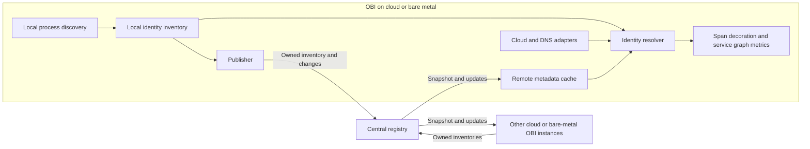

# Remote entity metadata service

Status: initial design proposal. Endpoint discovery and resolution-domain
decisions are specified below for review. Protocol details, scale targets, and
the metric counting policy remain pending.

## Purpose and initial scope

Allow OBI instances on cloud or bare-metal hosts to identify remote applications
when generating service graph metrics. Each OBI publishes its local application
inventory to a central registry and resolves peers from a local cache of registry
updates. Processing spans must not require a network request to the registry.

OBI running in Kubernetes continues to use the existing [K8s Cache](k8s-cache.md).
Kubernetes adapters and federation between these two metadata services are
outside this design.

The first version targets directly addressable cloud and bare-metal workloads. It supports
exact endpoints where known and falls back to IP when all known applications
at that address share the same `(service.name, service.namespace)`.
Multiple processes with that same identity are not ambiguous for the graph.
Undiscovered applications sharing the address can still cause incorrect
attribution; this limitation must be documented.

The registry initially runs as one in-memory instance, reconstructed from OBI
inventories after restart. Replication, distributed tracking of active
connections, NAT/load-balancer translation, and new cloud providers are outside
the initial scope. The identity model must accommodate future sources such as
Azure DNS and a separate node entity for network metadata.

## Data flow

Publish only locally owned application records, including their effective
identity after enrichment. Do not republish registry records or claim ownership
of remote entities inferred from cloud or DNS inventories.

## Identity and source model

Keep application records separate from address associations. Retain competing
associations and their provenance instead of overwriting a single IP-to-name map.

| Data | Purpose |
| --- | --- |
| Service name and namespace | Logical identity, matching the owner's exported telemetry. |
| Entity ID, publisher session, and revision | Instance lifecycle, idempotency, and protection against delayed updates. A PID alone is insufficient. |
| Addresses and optional port/transport | Exact endpoint lookup and IP fallback. |
| Resolution domain and source | Address interpretation, provenance, and conflict handling. |
| Metric coverage and validity | Whether the entity is known to generate server-side service graph metrics, independently of its identity. |

### Resolution domains

OBI automatically uses a common default resolution domain for its registry;
normal deployments require no domain configuration. An optional identifier
separates overlapping networks sharing the registry. Each OBI uses one domain,
and the registry partitions publication, subscriptions, and lookup accordingly.
The domain is independent of service namespace and is not inferred from a cloud
account, VPC ID, or hostname. Authorization must restrict domain access.

A domain groups observers that interpret advertised addresses consistently.
Connected VPCs or physical networks can share a domain when their addresses do
not collide. Separate domains isolate overlapping networks, even when they use
the same registry. A domain identifier does not translate addresses or discover
routes; interpreting one IP differently within a domain is unsupported.

Remote endpoint keys are `(domain, address, transport, port)`, where address is
an IP or a verified hostname; IP fallback uses `(domain, IP)`. Normalize hostnames
as lowercase FQDNs without a trailing dot and IPv4-mapped IPv6 as IPv4. A DNS
record or observed hostname alone does not establish a hostname-to-service
binding. Retain IPv4 and IPv6 as separate addresses. Local socket associations
also retain host/session and network namespace; loopback and namespace
identifiers never become remote lookup keys.

| Topology | Domain assignment |
| --- | --- |
| Directly connected, non-overlapping production networks | Common default domain; no additional configuration. |
| Isolated production/test networks both using `10.0.0.8` | Separate registries or optional distinct domains, such as `prod` and `test`. |
| Bridge container reachable only through a published host port | No inferred container-to-host endpoint translation; NAT mapping is outside the MVP. |

The existing [cloud inventory](../pkg/cloud/inventory.go) already has independent
source snapshots and a refresher interface. Extend that boundary and adapt
existing integrations rather than introducing a provider framework. Current
sources supply different evidence: ECS service membership, GCE instance-group
membership, Azure scale-set membership, and
[Route53 DNS names](route53-name-resolution.md). DNS aliases are not necessarily
application identities. Preserve source visibility and freshness when adding
new adapters; retain existing behavior during migration.

## Resolution policy

1. Look for a specific, valid endpoint-to-service association, using local
   process/socket knowledge, owner announcements, or verified platform/DNS
   associations. Local knowledge does not wait for registry updates.
2. If no specific association exists, look up the IP within its resolution
   domain. Use it only when all valid application records for that IP agree on
   one `(service.name, service.namespace)`.
3. If those records identify different services, report ambiguous. A DNS name
   alone must not hide that conflict.
4. If no application association exists, retain existing platform/DNS naming
   fallbacks, distinguishing an alias from a verified service identity. Report
   unknown when no usable evidence exists.

IP is not inherently more trustworthy than DNS: the fallback requires an
unambiguous application association. DNS evidence tied to a specific service
endpoint can contribute to step 1; a hostname alone may refer to multiple
services sharing an address. Keep resolution reasons available for diagnostics
without adding high-cardinality metric labels.

Specific endpoint lookup also requires one logical identity among its valid
owner records. Shared listeners or `SO_REUSEPORT` across different services are
ambiguous; multiple owners with the same name/namespace are not. An ambiguous
specific association must not fall through to a broader guess. Unknown means
no valid association; ambiguous means valid evidence identifies several services.

A client's ephemeral port is not a listening endpoint. Without an explicit
connection association, resolve that client through the agreed IP fallback.
Tracking such connections across nodes is not required for the first version.

For applications on the same node, include network-namespace context and reuse
local process information where possible. The current
[self-reference check](../pkg/appolly/app/request/span.go) compares IPs and
namespaces without checking service names or ports. It must be revisited so
distinct services sharing a host address are not silently excluded.

## Local inventory lifecycle

Maintain the inventory from enriched process events, before filtering by metric
selection. Key process ownership by publisher session, host PID, and process
start time. A repeated creation event updates the existing record; publish
identity/address/coverage changes and remove only that owner's associations on
termination. Keep identity available independently of enabled signals.

### Address collection

Autodetect addresses without requiring IP lists or interface selection. For
host addresses, prefer the cloud provider's local instance metadata when
available; use local interface discovery on bare metal or when cloud metadata
is unavailable. Optional filters are advanced overrides, not prerequisites.
Cloud metadata establishes assignment to an instance, not process ownership or
reachability from every peer. Local sockets remain the source of listener
bindings. Preserve provenance and ambiguity rules in both discovery paths.

Reuse provider detection, SDK clients, and timeout/retry handling from
[NodeMeta](../pkg/metadata/meta_node.go) and the existing
[EC2 metadata reader](../pkg/metadata/meta_node_ec2.go). Extend local metadata
collection with a refreshable network snapshot; `NodeMeta` is collected at
startup and currently stores no interface-address inventory. Keep network
discovery data separate from exported resource attributes. Read all relevant
NICs and assigned addresses, not just the primary interface or an alias prefix.

| Source | Reuse and publication rule |
| --- | --- |
| Local cloud instance metadata | Prefer assigned, directly addressed host IPs for host processes, with NIC/network provenance where available. Do not automatically add unrelated local bridge/VPN addresses to a successful cloud snapshot. |
| Isolated container or task | Prefer metadata tied to that specific container/task when available; otherwise reuse [IPsForPID](../pkg/internal/helpers/container/ips.go). OBI's own task metadata does not describe every instrumented container, and VM addresses must not be copied onto each container. |
| Local host interfaces | Fallback in the target process's namespace using [WithNetNS](../pkg/internal/netns/netns.go). `IPsForPID` deliberately returns no host addresses. |
| Remote cloud inventory or DNS | Keep as resolver evidence; do not announce independently discovered remote entities. |

AWS exposes per-NIC addresses through [EC2 IMDS](https://docs.aws.amazon.com/AWSEC2/latest/UserGuide/ec2-instance-metadata.html);
[GCE metadata](https://docs.cloud.google.com/compute/docs/metadata/predefined-metadata-keys)
and [Azure IMDS](https://learn.microsoft.com/en-us/azure/virtual-machines/instance-metadata-service)
also expose network-interface data. Distinguish directly assigned addresses from
public/NAT mappings, forwarded addresses, and alias ranges. Do not expand a
prefix into application endpoints or infer a public listener by copying a
private listener's port. NAT translation remains outside the MVP.

Reuse or extend NetworkMetrics' interface-monitoring and optional filtering
primitives behind [InterfaceManager](../pkg/internal/ebpf/tcmanager/ifacemanager.go)
for local discovery and change hints, without requiring network metrics to be
enabled or inheriting their capture filters. Current interface events contain
name/index, not IP changes; reconcile addresses periodically and refresh cloud
snapshots too. A transient provider failure may retain its last successful
snapshot only within its validity window; missing data is not a confirmed
deletion. Fall back automatically when no usable provider snapshot exists,
retaining the weaker provenance. Exact override fields belong to Config v2.

Enumerate once per network namespace per scan. Exclude unspecified, loopback,
multicast, and link-local addresses from publication; private unicast addresses
are valid within their domain. Retain loopback bindings locally. Do not reuse
the agent IP as the complete application address set: the agent may occupy a
different namespace or report only one interface.

Associating autodetected host addresses with a process enables the agreed IP
fallback; it does not prove that the process listens on every interface. A
client-only process can therefore have IP associations without listener records.

### Listener collection and refresh

Use the existing gopsutil dependency's per-PID TCP socket enumeration, retaining
local address, port, family, and `LISTEN` state before discovery reduces results
to port numbers. On Linux it matches process socket descriptors to
`/proc/<pid>/net/tcp{,6}`. Publish only TCP listeners initially; retain transport
in the model for future UDP support. Established/client ports are not published
as listeners or sent as a distributed connection inventory.

For a specific bind, publish its eligible address. Expand wildcard binds only
over autodetected eligible addresses in the same namespace and address family;
never publish `0.0.0.0` or `::`. Do not infer IPv4 acceptance from an IPv6 wildcard
without verifying dual-stack behavior. Loopback listeners remain local.

Scan on process discovery and reconcile while the process is alive, using the
existing discovery polling cadence initially. A process need not restart for
listeners or interfaces to change. Deduplicate interface reads and publish only
diffs. The current [port watcher](../pkg/internal/ebpf/watcher/watcher.go) and
[listener map](../bpf/generictracer/maps/listening_ports.h) can provide hints, but
neither supplies a complete service-owned endpoint snapshot; no new eBPF probes
are required for this initial approach.

Validate process start time and namespace around collection to reject PID-reuse
races. Check `/proc` access explicitly: gopsutil can return an empty result after
a descriptor-read failure. Failed or partial scans must not be treated as a
successful empty inventory or renew unverified associations indefinitely; retain
previous evidence only within its validity window and expose the failure.
Remove disappeared bindings after a successful reconciliation, retaining other
live owners of shared listeners.

The IP fallback considers all valid application records, not only those with
listeners. Applications excluded from discovery remain invisible and can cause
incorrect attribution even when the known records agree. Duplicate bridge IPs
across hosts and translated endpoints require different domains or unsupported
translation; never select an arbitrary owner.

## Registry and synchronization

Use Protobuf and gRPC streaming, following the deployment pattern of
[K8s Cache](k8s-cache.md), with separate publication and subscription RPCs:

- `Publish`: bidirectional stream for inventory replacement, upserts, deletes,
  lease renewal, and acknowledgements.
- `Watch`: server stream carrying a consistent snapshot followed by changes.

The registry assigns an epoch and ordered revisions. Serialize snapshot capture
with subsequent updates so no changes are lost at the boundary. Replace a
publisher's inventory atomically after receiving its complete snapshot; fence
old sessions so their delayed messages cannot overwrite or delete newer records.

Reconnects initially use full snapshots, not durable event replay. Consumers
replace the registry-owned portion of their cache atomically and preserve local
and other-source data. A new registry epoch requires synchronization again.
Retry with exponential backoff and jitter; registry failure must not stop local
instrumentation or block span processing indefinitely.

Use leases with a grace period to recover from missing deletes. Propagate enough
validity information for disconnected consumers to expire stale records too.
Identity and metric-coverage validity may differ: a cached name can remain useful
after the claim that its server metrics are active becomes uncertain.

Bound queues, snapshot size, and inventories per authenticated publisher. Close
slow subscriptions and resynchronize them rather than dropping updates silently
or allowing unbounded memory growth. Authenticate publishers and subscribers,
authorize their resolution domains, and support TLS.

Independent replicas behind a load balancer would hold different inventories.
True replication needs shared state or consensus and is deferred. A passive
replacement without replicated state still needs to rebuild its inventory.

## Service graph semantics

Share identities and observation capabilities, not spans or metric values.
Durations, errors, and protocol-specific connection types remain derived from
local spans. Preserve separate client and server latency histograms.

Today, [client-side request counting](../pkg/export/otel/metrics_svc_graph.go)
uses a local service-name tracker to decide whether the server is instrumented;
errors can be counted from both sides. Remote metadata alone does not fix these
semantics. Define one counting policy for both Prometheus and OTLP exporters,
including failures, `virtual_node`, partial instrumentation, and stale coverage.

Represent coverage as active, inactive, or unknown at entity/endpoint granularity
where possible. One observed replica does not establish coverage for every
replica of the logical service. The registry provides eventual consistency,
not exactly-once counting during startup, configuration changes, or partitions.

## Validation and remaining decisions

Before implementing the protocol, review the endpoint-discovery decisions above
and settle the counting policy for unknown coverage. Select lease/cache defaults and
resource limits after confirming deployment topology and expected scale.

Validate listener ownership, inherited/shared descriptors, namespace entry,
wildcard/dual-stack binds, permission failures, and binding changes in Linux
integration tests when implementing the collector. Current discovery evidence
is source inspection, including gopsutil v4.26.9; it is not a live collector test.

Acceptance scenarios cover separate nodes; distinct services sharing one node
or IP; loopback and container networking; conflicting sources; mixed replica
coverage; identity changes and PID/IP reuse; publisher and registry restarts;
partitions, lost deletes, and slow subscribers. Exercise both exporters.

Measure snapshot size, update fan-out, convergence time, and memory. With N OBI
subscribers and U published changes per second, full broadcast requires roughly
N × U deliveries; benchmark before adding subscription filters or replication.
Expose cache synchronization/freshness, conflicts, expirations, queue pressure,
and reconnects. New settings belong to Config v2, with protocol-version checks
and an explicit mixed-version compatibility policy.
