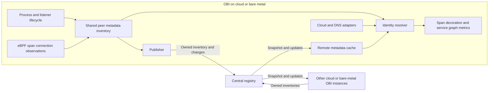

# Remote entity metadata service

Status: initial design, revised after review. Reuse boundaries and topology
conflict handling are specified below; protocol details, scale targets, and the
metric counting policy remain pending.

## Purpose and initial scope

Allow OBI instances on cloud or bare-metal hosts to identify remote applications
when generating service graph metrics. Each OBI publishes its local application
inventory to a central registry and resolves peers from a local cache of registry
updates. Processing spans must not require a network request to the registry.

The registry is an alternative transport for the shared local metadata model in
the [peer-exchange proposal](https://github.com/open-telemetry/opentelemetry-ebpf-instrumentation/pull/3806),
for deployments where direct OBI-to-OBI communication is unavailable. Reuse its
inventory, connection observations, and resolution behavior rather than building
a second discovery system. That proposal is still under review and its code is
not yet in this checkout; extracting the reusable boundary is an implementation
prerequisite, not an assumption that the APIs are already available on main.
Registry-only mode must run the shared inventory/resolver without starting the
peer HTTP listener or querying peers; only outbound registry connectivity is
required. Reuse the data-producing components, not the peer transport lifecycle.

OBI running in Kubernetes continues to use the existing [K8s Cache](k8s-cache.md).
Kubernetes adapters and federation between these two metadata services are
outside this design.

The first version targets directly addressable cloud and bare-metal workloads. It supports
exact endpoints where known and falls back to IP when ownership is not contested
and all known applications at that address share the same
`(service.name, service.namespace)`.
Multiple processes with that same identity are not ambiguous for the graph.
Undiscovered applications sharing the address can still cause incorrect
attribution; this limitation must be documented.

The registry initially runs as one in-memory instance, reconstructed from OBI
inventories after restart. Replication, distributed tracking of active
connections, NAT/load-balancer translation, and new cloud providers are outside
the initial scope. The identity model must accommodate future sources such as
Azure DNS and a separate node entity for network metadata.

## Data flow

Publish only locally owned application records, including their effective
identity after enrichment. Do not republish registry records or claim ownership
of remote entities inferred from cloud or DNS inventories.

## Identity and source model

Keep application records separate from address associations. Retain competing
associations and their provenance instead of overwriting a single IP-to-name map.

| Data | Purpose |
| --- | --- |
| Service name and namespace | Logical identity, matching the owner's exported telemetry. |
| Entity ID, publisher session, and revision | Instance lifecycle, idempotency, and protection against delayed updates. A PID alone is insufficient. |
| Stable host identity, hostname, and network provenance | Distinguish service ambiguity from cross-host address collisions and provide a human-readable fallback. |
| Addresses and optional port/transport | Exact endpoint lookup and IP fallback. |
| Resolution domain and source | Address interpretation, provenance, and conflict handling. |
| Metric coverage and validity | Whether the entity is known to generate server-side service graph metrics, independently of its identity. |

### Resolution domains

OBI automatically uses a common default resolution domain for its registry;
normal deployments require no domain configuration. An optional identifier
separates overlapping networks sharing the registry. Each OBI uses one domain,
and the registry partitions publication, subscriptions, and lookup accordingly.
The domain is independent of service namespace and is not inferred from a cloud
account, VPC ID, or hostname. Authorization must restrict domain access.

A domain groups observers that interpret advertised addresses consistently.
Connected VPCs or physical networks can share a domain when their addresses do
not collide. Separate domains isolate overlapping networks, even when they use
the same registry. A domain identifier does not translate addresses or discover
routes; interpreting one IP differently within a domain is unsupported.

The MVP publishes endpoint keys `(domain, IP, transport, port)` and IP fallback
associations `(domain, IP)`. Normalize IPv4-mapped IPv6 as IPv4; retain native
IPv4 and IPv6 as separate addresses. The model can later support hostname/port
associations when a source explicitly establishes hostname-to-service ownership.
Ordinary DNS records or observed hostnames do not establish that binding and
remain naming/resolution evidence. Local socket associations also retain
host/session and network namespace; loopback and namespace identifiers never
become remote lookup keys.

### Address-space conflicts

Do not rely on operators noticing overlapping networks. Retain authenticated
publisher/session ownership, stable host identity independent of telemetry
`host.id` overrides, and available network provenance for every address claim.
Use existing cloud network IDs or prefixes as corroborating evidence; different
VPC IDs alone are not a conflict because non-overlapping connected VPCs can share
a domain. Neither DNS nor Route53 is required for admission or conflict detection.

If distinct hosts claim the same IP in one domain and the registry cannot
establish that the claimants represent the same host, reject that key as unsafe
for service attribution, even when service names agree. Keep a contested-key
marker and claimant provenance; do not let the first or latest publisher win.
Invalidate previously distributed mappings for that address, including endpoint
lookups that cannot establish a unique network scope, and immediately notify all
affected subscribers. Other non-conflicting records remain usable.

Several processes/listeners on the same established host are ordinary service
ambiguity, not automatically a network configuration error. Multiple OBI sessions
must not be merged into one host solely because their IP or hostname matches.
Likewise, a shared virtual IP needs explicit ownership evidence; guessing VIP or
NAT semantics is outside the MVP. An observed socket tuple establishes the
address at that capture point, not a global route or post-NAT address mapping.

Return a structured conflict result to publishers and subscribers. Emit bounded,
rate-limited diagnostics identifying the domain, address, and conflicting owners,
plus aggregate conflict metrics without per-IP labels. Tell the operator to
separate overlapping networks into registries/domains or correct the conflicting
claims. Clear the marker only after withdrawals/expiry leave unambiguous valid
ownership, and publish that resolution as another ordered update. Reliable
overlapping-prefix evidence can warn earlier; missing topology metadata must not
disable claim-level collision detection.

| Topology | Domain assignment |
| --- | --- |
| Directly connected, non-overlapping production networks | Common default domain; no additional configuration. |
| Isolated production/test networks both using `10.0.0.8` | Separate registries or optional distinct domains, such as `prod` and `test`. |
| Bridge container reachable only through a published host port | No inferred container-to-host endpoint translation; NAT mapping is outside the MVP. |

The existing [cloud inventory](../pkg/cloud/inventory.go) already has independent
source snapshots and a refresher interface. Extend that boundary and adapt
existing integrations rather than introducing a provider framework. Current
sources supply different evidence: ECS service membership, GCE instance-group
membership, Azure scale-set membership, and
[Route53 DNS names](route53-name-resolution.md). DNS aliases are not necessarily
application identities. Preserve source visibility and freshness when adding
new adapters; retain existing behavior during migration.

## Resolution policy

1. Look for a specific, valid endpoint-to-service association, using local
   process/socket knowledge, owner announcements, or verified platform
   associations. Local knowledge does not wait for registry updates.
2. If no specific association exists, look up the IP within its resolution
   domain. Use it only when all valid application records for that IP agree on
   one `(service.name, service.namespace)`.
3. If those records identify different services, preserve an ambiguous identity
   result and display the known peer hostname, or a DNS name appropriate to the
   observer. Do not select one competing service or copy its namespace/coverage.
4. For unknown identities, use the same human-readable fallback. If no usable
   hostname/DNS name exists, retain the existing IP/unresolved-name behavior.

A topology conflict blocks service attribution but need not produce an opaque
graph label. Use only an independently valid observer-side DNS name or an
unambiguously identified host's hostname; never pick a hostname from conflicting
owners. Keep conflict/ambiguity state internally even when displaying a name.
A hostname fallback carries no inferred service namespace or graph coverage.

Prefer a meaningful hostname/DNS label to a raw IP whenever service identity is
unknown or ambiguous, matching peer-exchange behavior. This is a display/name
fallback, not proof of service identity, network uniqueness, or graph coverage.
In the MVP DNS does not publish hostname-to-service ownership; Route53 remains
optional and must not conceal contested address claims. Keep resolution reasons
available for diagnostics without high-cardinality metric labels.

Specific endpoint lookup also requires one logical identity among its valid
owner records. Shared listeners or `SO_REUSEPORT` across different services are
ambiguous; multiple owners with the same name/namespace are not. An ambiguous
specific association must not fall through to another service guess; hostname
fallback remains available. Unknown means
no valid association; ambiguous means valid evidence identifies several services.

A client's ephemeral port is not a listening endpoint. Without an explicit
connection association, reuse the peer inventory's bounded, expiring
service-to-destination caller observations where available, then the agreed IP
fallback. These aggregate observations are not per-connection identities and do
not require publishing ephemeral ports. Preserve their expiry and overflow
ambiguity through the registry; incomplete sets must not appear unique.

For applications on the same node, include network-namespace context and reuse
local process information where possible. The current
[self-reference check](../pkg/appolly/app/request/span.go) compares IPs and
namespaces without checking service names or ports. It must be revisited so
distinct services sharing a host address are not silently excluded.

## Local inventory lifecycle

Maintain the inventory from enriched process events, before filtering by metric
selection. Key process ownership by publisher session, host PID, and process
start time. A repeated creation event updates the existing record; publish
identity/address/coverage changes and remove only that owner's associations on
termination. Keep identity available independently of enabled signals.

### Address collection

Reuse addresses already carried by eBPF spans and the peer metadata inventory.
For a client span, the source endpoint belongs to the observed local service;
for a server span, the destination endpoint does. Do not claim the remote side
as locally owned. Connection metadata is independent of HTTP headers; validate
the orientation and available fields for each supported event type, including
failed connections. Protocol-specific names are naming evidence, not ownership.

Keep process/listener inventory so selected applications can be announced before
their first request. Observation-only learning does not discover idle workloads.
Reuse existing automatic local-address discovery to supplement observations,
without requiring IP lists, interface selection, cloud credentials, or access to
an instance-metadata endpoint. Filters remain optional advanced overrides.

| Source | Reuse and publication rule |
| --- | --- |
| Span connection tuples | Primary evidence for observed local addresses, with the emitting service identity and capture-point provenance. |
| Shared peer inventory | Reuse process lifecycle, hostname, listener attribution, and expiring caller observations; adapt publication to the registry. |
| Local namespaces/interfaces | Supplement cold or incomplete observations using existing helpers such as [IPsForPID](../pkg/internal/helpers/container/ips.go) and [WithNetNS](../pkg/internal/netns/netns.go), respecting container boundaries. |
| Existing cloud metadata | Optional identity/network-scope enrichment through [NodeMeta](../pkg/metadata/meta_node.go) and existing clients; no mandatory second address-discovery system. |
| Remote cloud inventory or DNS | Optional resolver/naming evidence; do not announce independently discovered remote entities. |

Known addresses from sockets are not proof of a globally reachable external IP.
Do not infer public/NAT mappings, expand cloud alias ranges into endpoints, or
copy VM addresses onto every container. OBI's own task metadata does not describe
all instrumented containers. Cross-NAT/proxy translation remains outside the MVP.

Reuse or extend NetworkMetrics' interface-monitoring and optional filtering
primitives behind [InterfaceManager](../pkg/internal/ebpf/tcmanager/ifacemanager.go)
for supplementary discovery/change hints, without requiring network metrics to
be enabled or inheriting their capture filters. Current interface events contain
name/index, not IP changes; retain periodic reconciliation. Reuse the peer
inventory's refresh loop rather than add another listener poller. Failed or
incomplete discovery must not imply removal of omitted addresses. Any optional
cloud enrichment follows its existing refresh policy; registry updates never
wait on a provider query.

Enumerate once per network namespace per scan. Exclude unspecified, loopback,
multicast, and link-local addresses from publication; private unicast addresses
are valid within their domain. Retain loopback bindings locally. Do not reuse
the agent IP as the complete application address set: the agent may occupy a
different namespace or report only one interface.

Associating autodetected host addresses with a process enables the agreed IP
fallback; it does not prove that the process listens on every interface. A
client-only process can therefore have IP associations without listener records.

### Listener collection and refresh

Reuse the peer proposal's process inventory and per-PID TCP `LISTEN` enumeration,
which already use gopsutil and process start times. Expose shared inventory
changes to the registry publisher instead of implementing another collector.
Publish only TCP listeners initially; retain transport in the model for future
UDP support. Established/client ports are not published as listeners.

For a specific bind, publish its eligible address. Expand wildcard binds only
over autodetected eligible addresses in the same namespace and address family;
never publish `0.0.0.0` or `::`. Do not infer IPv4 acceptance from an IPv6 wildcard
without verifying dual-stack behavior. Loopback listeners remain local.

Scan on process discovery and reconcile while the process is alive, using the
existing discovery polling cadence initially. A process need not restart for
listeners or interfaces to change. Deduplicate interface reads and publish only
diffs. The current [port watcher](../pkg/internal/ebpf/watcher/watcher.go) and
[listener map](../bpf/generictracer/maps/listening_ports.h) can provide hints, but
neither supplies a complete service-owned endpoint snapshot; no new eBPF probes
are required for this initial approach.

Reuse still needs parity tests: the peer proposal currently records wildcard
listeners and tries IPv6 wildcard as possible dual-stack fallback. Preserve its
hostname fallback, but do not turn wildcard records into globally owned IPs or
silently assume IPv4 reachability; reconcile these cases in the shared resolver.

Validate process start time and namespace around collection to reject PID-reuse
races. Check `/proc` access explicitly: gopsutil can return an empty result after
a descriptor-read failure. Failed or partial scans must not be treated as a
successful empty inventory or renew unverified associations indefinitely; retain
previous evidence only within its validity window and expose the failure.
Remove disappeared bindings after a successful reconciliation, retaining other
live owners of shared listeners.

The IP fallback considers all valid application records, not only those with
listeners. Applications excluded from discovery remain invisible and can cause
incorrect attribution even when the known records agree. Duplicate bridge IPs
across hosts and translated endpoints require different domains or unsupported
translation; never select an arbitrary owner.

## Registry and synchronization

Use Protobuf and gRPC streaming, following the deployment pattern of
[K8s Cache](k8s-cache.md), with separate publication and subscription RPCs:

- `Publish`: bidirectional stream for inventory replacement, upserts, deletes,
  lease renewal, and acknowledgements.
- `Watch`: server stream carrying a consistent snapshot followed by changes.

Carry host identity/hostname, scoped address claims and provenance, shared
listener/caller data, and independent observation lifetimes. Include structured
claim rejection, contested-key invalidation, and recovery events in the same
ordered stream; a subscription snapshot must carry existing conflict markers.

On each accepted publisher update, apply the change to the in-memory registry
and immediately enqueue it for subscribers; do not wait for a polling cycle or
another provider read. Retain records across lookups until an explicit owner
removal or expiry of their owner-confirmed validity. Initial/reconnection
snapshots synchronize existing state; normal operation streams changes.

The registry assigns an epoch and ordered revisions. Serialize snapshot capture
with subsequent updates so no changes are lost at the boundary. Replace a
publisher's inventory atomically after receiving its complete snapshot; fence
old sessions so their delayed messages cannot overwrite or delete newer records.

Reconnects initially use full snapshots, not durable event replay. Consumers
replace the registry-owned portion of their cache atomically and preserve local
and other-source data. A new registry epoch requires synchronization again.
Retry with exponential backoff and jitter; registry failure must not stop local
instrumentation or block span processing indefinitely.

Use leases with a grace period to recover from missing deletes. Propagate enough
validity information for disconnected consumers to expire stale records too.
Identity and metric-coverage validity may differ: a cached name can remain useful
after the claim that its server metrics are active becomes uncertain.
Renewal requires the owner to confirm the entity still exists, including during
idle periods with no application traffic. Subscriber reads do not renew that
validity, and lack of reads does not establish that a service has stopped.
Any idle-cache eviction is local, not a service deletion to broadcast. Expiry
means stale/unknown ownership after missed confirmations, not proof of process
termination; explicit lifecycle removal is the direct termination signal.

Bound queues, snapshot size, and inventories per authenticated publisher. Close
slow subscriptions and resynchronize them rather than dropping updates silently
or allowing unbounded memory growth. Authenticate publishers and subscribers,
authorize their resolution domains, and support TLS.

Independent replicas behind a load balancer would hold different inventories.
True replication needs shared state or consensus and is deferred. A passive
replacement without replicated state still needs to rebuild its inventory.

## Service graph semantics

Share identities and observation capabilities, not spans or metric values.
Durations, errors, and protocol-specific connection types remain derived from
local spans. Preserve separate client and server latency histograms.

Today, [client-side request counting](../pkg/export/otel/metrics_svc_graph.go)
uses a local service-name tracker to decide whether the server is instrumented;
errors can be counted from both sides. Remote metadata alone does not fix these
semantics. Define one counting policy for both Prometheus and OTLP exporters,
including failures, `virtual_node`, partial instrumentation, and stale coverage.

Represent coverage as active, inactive, or unknown at entity/endpoint granularity
where possible. One observed replica does not establish coverage for every
replica of the logical service. The registry provides eventual consistency,
not exactly-once counting during startup, configuration changes, or partitions.
Reuse the peer proposal's per-service graph flags, protocol selection, and
caller-acknowledgement evidence as inputs to this policy. A hostname fallback
must not be mistaken for an instrumented application. Retention of these fields
through a registry transport is part of the counting design, not automatic
equivalence of delivery acknowledgements and server observation coverage.

## Validation and remaining decisions

Endpoint-discovery decisions are specified above. Before implementing the
protocol, settle the counting policy for unknown coverage. Select lease/cache
defaults and resource limits after confirming deployment topology and expected scale.
Before implementing the inventory/publisher, identify the shared extraction
points from the peer proposal and review compatibility while it remains unmerged.

Validate listener ownership, inherited/shared descriptors, namespace entry,
wildcard/dual-stack binds, permission failures, and binding changes in Linux
integration tests when implementing the collector. Current discovery evidence
is source inspection, including gopsutil v4.26.9; it is not a live collector test.

Acceptance scenarios cover separate nodes; distinct services sharing one node
or IP; loopback and container networking; conflicting sources; mixed replica
coverage; identity changes and PID/IP reuse; publisher and registry restarts;
partitions, lost deletes, and slow subscribers. Exercise both exporters.
Add transport-parity tests for peer and registry resolution, hostname fallback
under service ambiguity, operation without Route53/cloud metadata, and topology
conflicts between hosts with identical IPs and even identical service names.
Verify invalidation of earlier mappings, snapshot/reconnect conflict replay,
withdrawal/expiry recovery, and actionable bounded diagnostics. Different ports
on one host must not be rejected as a cross-network configuration error.

Measure snapshot size, update fan-out, convergence time, and memory. With N OBI
subscribers and U published changes per second, full broadcast requires roughly
N × U deliveries; benchmark before adding subscription filters or replication.
Expose cache synchronization/freshness, conflicts, expirations, queue pressure,
and reconnects. New settings belong to Config v2, with protocol-version checks
and an explicit mixed-version compatibility policy.
