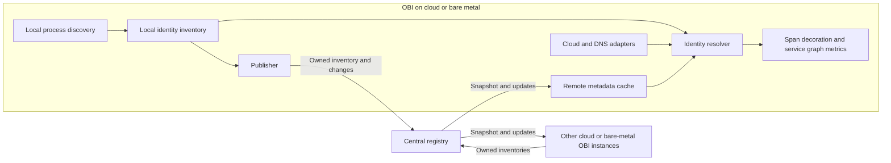

# Remote entity metadata service

Status: initial design proposal. Protocol details, scale targets, and metric
counting policy still need validation before implementation.

## Purpose and initial scope

Allow OBI instances on cloud or bare-metal hosts to identify remote applications
when generating service graph metrics. Each OBI publishes its local application
inventory to a central registry and resolves peers from a local cache of registry
updates. Processing spans must not require a network request to the registry.

OBI running in Kubernetes continues to use the existing [K8s Cache](k8s-cache.md).
Kubernetes adapters and federation between these two metadata services are
outside this design.

The first version targets directly addressable cloud and bare-metal workloads. It supports
exact endpoints where known and falls back to IP when all known applications
at that address share the same `(service.name, service.namespace)`.
Multiple processes with that same identity are not ambiguous for the graph.
Undiscovered applications sharing the address can still cause incorrect
attribution; this limitation must be documented.

The registry initially runs as one in-memory instance, reconstructed from OBI
inventories after restart. Replication, distributed tracking of active
connections, NAT/load-balancer translation, and new cloud providers are outside
the initial scope. The identity model must accommodate future sources such as
Azure DNS and a separate node entity for network metadata.

## Data flow

Publish only locally owned application records, including their effective
identity after enrichment. Do not republish registry records or claim ownership
of remote entities inferred from cloud or DNS inventories.

## Identity and source model

Keep application records separate from address associations. Retain competing
associations and their provenance instead of overwriting a single IP-to-name map.

| Data | Purpose |
| --- | --- |
| Service name and namespace | Logical identity, matching the owner's exported telemetry. |
| Entity ID, publisher session, and revision | Instance lifecycle, idempotency, and protection against delayed updates. A PID alone is insufficient. |
| Addresses and optional port/transport | Exact endpoint lookup and IP fallback. |
| Resolution domain and source | Address interpretation, provenance, and conflict handling. |
| Metric coverage and validity | Whether the entity is known to generate server-side service graph metrics, independently of its identity. |

A resolution domain groups observers that interpret addresses consistently.
It may span connected VPCs or physical networks; using the observer's VPC ID as the lookup
scope would hide peers in another connected VPC. Initially configure domains
explicitly. Overlapping address spaces require separate domains or a future
translation mechanism. Loopback and local network-namespace identifiers remain
local and must not become globally resolvable addresses.

The existing [cloud inventory](../pkg/cloud/inventory.go) already has independent
source snapshots and a refresher interface. Extend that boundary and adapt
existing integrations rather than introducing a provider framework. Current
sources supply different evidence: ECS service membership, GCE instance-group
membership, Azure scale-set membership, and
[Route53 DNS names](route53-name-resolution.md). DNS aliases are not necessarily
application identities. Preserve source visibility and freshness when adding
new adapters; retain existing behavior during migration.

## Resolution policy

1. Look for a specific, valid endpoint-to-service association, using local
   process/socket knowledge, owner announcements, or verified platform/DNS
   associations. Local knowledge does not wait for registry updates.
2. If no specific association exists, look up the IP within its resolution
   domain. Use it only when all valid application records for that IP agree on
   one `(service.name, service.namespace)`.
3. If those records identify different services, report ambiguous. A DNS name
   alone must not hide that conflict.
4. If no application association exists, retain existing platform/DNS naming
   fallbacks, distinguishing an alias from a verified service identity. Report
   unknown when no usable evidence exists.

IP is not inherently more trustworthy than DNS: the fallback requires an
unambiguous application association. DNS evidence tied to a specific service
endpoint can contribute to step 1; a hostname alone may refer to multiple
services sharing an address. Keep resolution reasons available for diagnostics
without adding high-cardinality metric labels.

A client's ephemeral port is not a listening endpoint. Without an explicit
connection association, resolve that client through the agreed IP fallback.
Tracking such connections across nodes is not required for the first version.

For applications on the same node, include network-namespace context and reuse
local process information where possible. The current
[self-reference check](../pkg/appolly/app/request/span.go) compares IPs and
namespaces without checking service names or ports. It must be revisited so
distinct services sharing a host address are not silently excluded.

## Local inventory lifecycle

Maintain the inventory from enriched process events, before filtering by metric
selection. Publish creations, identity/address/coverage changes, and removals;
an existing process can receive another creation event when its metadata changes.
Keep identity available independently of enabled signals.

Endpoint collection needs a focused implementation decision. Isolated-container
IP helpers are available. Host processes need explicit host
address handling. Existing process port discovery includes ephemeral ports,
while the eBPF listener map alone does not associate listeners with service
identities. Do not advertise either as a complete endpoint inventory.

## Registry and synchronization

Use Protobuf and gRPC streaming, following the deployment pattern of
[K8s Cache](k8s-cache.md), with separate publication and subscription RPCs:

- `Publish`: bidirectional stream for inventory replacement, upserts, deletes,
  lease renewal, and acknowledgements.
- `Watch`: server stream carrying a consistent snapshot followed by changes.

The registry assigns an epoch and ordered revisions. Serialize snapshot capture
with subsequent updates so no changes are lost at the boundary. Replace a
publisher's inventory atomically after receiving its complete snapshot; fence
old sessions so their delayed messages cannot overwrite or delete newer records.

Reconnects initially use full snapshots, not durable event replay. Consumers
replace the registry-owned portion of their cache atomically and preserve local
and other-source data. A new registry epoch requires synchronization again.
Retry with exponential backoff and jitter; registry failure must not stop local
instrumentation or block span processing indefinitely.

Use leases with a grace period to recover from missing deletes. Propagate enough
validity information for disconnected consumers to expire stale records too.
Identity and metric-coverage validity may differ: a cached name can remain useful
after the claim that its server metrics are active becomes uncertain.

Bound queues, snapshot size, and inventories per authenticated publisher. Close
slow subscriptions and resynchronize them rather than dropping updates silently
or allowing unbounded memory growth. Authenticate publishers and subscribers,
authorize their resolution domains, and support TLS.

Independent replicas behind a load balancer would hold different inventories.
True replication needs shared state or consensus and is deferred. A passive
replacement without replicated state still needs to rebuild its inventory.

## Service graph semantics

Share identities and observation capabilities, not spans or metric values.
Durations, errors, and protocol-specific connection types remain derived from
local spans. Preserve separate client and server latency histograms.

Today, [client-side request counting](../pkg/export/otel/metrics_svc_graph.go)
uses a local service-name tracker to decide whether the server is instrumented;
errors can be counted from both sides. Remote metadata alone does not fix these
semantics. Define one counting policy for both Prometheus and OTLP exporters,
including failures, `virtual_node`, partial instrumentation, and stale coverage.

Represent coverage as active, inactive, or unknown at entity/endpoint granularity
where possible. One observed replica does not establish coverage for every
replica of the logical service. The registry provides eventual consistency,
not exactly-once counting during startup, configuration changes, or partitions.

## Validation and remaining decisions

Before implementing the protocol, settle endpoint collection, resolution-domain
configuration, and the counting policy for unknown coverage. Select lease and
cache defaults after confirming deployment topology and expected scale.

Acceptance scenarios cover separate nodes; distinct services sharing one node
or IP; loopback and container networking; conflicting sources; mixed replica
coverage; identity changes and PID/IP reuse; publisher and registry restarts;
partitions, lost deletes, and slow subscribers. Exercise both exporters.

Measure snapshot size, update fan-out, convergence time, and memory. With N OBI
subscribers and U published changes per second, full broadcast requires roughly
N × U deliveries; benchmark before adding subscription filters or replication.
Expose cache synchronization/freshness, conflicts, expirations, queue pressure,
and reconnects. New settings belong to Config v2, with protocol-version checks
and an explicit mixed-version compatibility policy.
